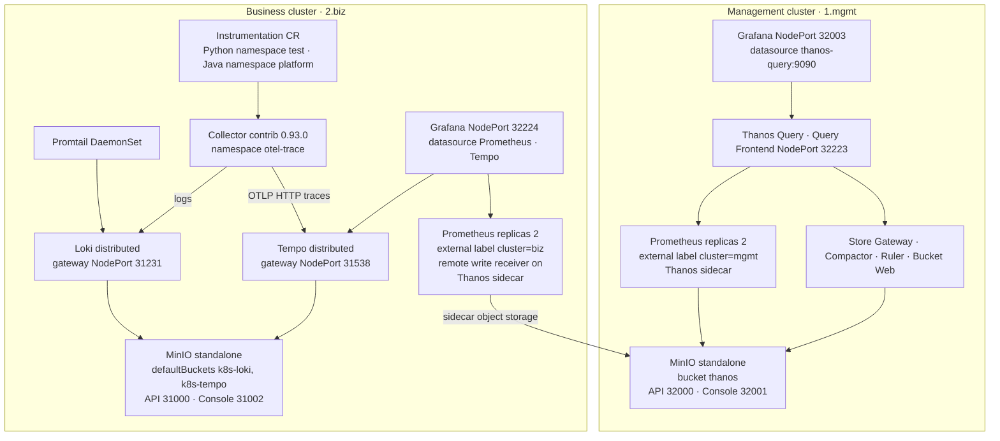

# Kubernetes 멀티 클러스터 Observability 패키지

[](https://kubernetes.io/)
[](https://helm.sh/)
[](https://prometheus.io/)
[](https://grafana.com/)
[](https://thanos.io/)
[](https://grafana.com/oss/loki/)
[](https://grafana.com/oss/tempo/)
[](https://opentelemetry.io/)
[](https://min.io/)
[](https://grafana.com/docs/loki/latest/send-data/promtail/)

Management 클러스터의 Thanos와 Business 클러스터의 metrics, logs, traces를 벤더 Helm 차트와 OpenTelemetry 매니페스트로 배포하는 패키지입니다.

저장소 이력의 패키징 이름은 `Monitoring_v3.0.5`입니다. 대시보드와 예전 가이드의 경로에는 `Platform` / `platform-monitoring` 이름이 남아 있습니다. 차트 대부분은 업스트림 Helm 차트를 통째로 포함한 것이고, 이 저장소에서 맞춘 부분은 `values.yaml`, Management Grafana 대시보드, OpenTelemetry 매니페스트, 설치 순서입니다.

클러스터별 원문 절차는 [1.mgmt/README.md](1.mgmt/README.md)와 [2.biz/README.md](2.biz/README.md)에 있습니다. 그 문서의 HAProxy 예시와 명령 출력에는 특정 환경의 주소가 들어 있으므로, 아래 절차는 저장소 안의 명령과 현재 values를 기준으로 적었습니다.

## 배경과 목적

패키지는 역할을 두 클러스터로 나눕니다.

- `1.mgmt`는 장기 metrics를 모읍니다. Prometheus Thanos sidecar가 Management MinIO의 `thanos` 버킷에 블록을 올리고, Thanos Query가 그 저장소와 sidecar를 조회합니다. Grafana datasource는 클러스터 내부의 `thanos-query`입니다.
- `2.biz`는 워크로드에 가까운 수집을 맡습니다. kube-prometheus-stack, Promtail, Loki, Tempo, OpenTelemetry Collector가 있고, Loki와 Tempo의 객체 저장소는 Business MinIO입니다. Business Prometheus sidecar도 Management MinIO의 `thanos` 버킷을 object storage로 쓰도록 secret 이름 `thanos-minio-secret`을 참조합니다.

신호를 나누면 다음과 같습니다.

| 신호 | Business 클러스터에서 수집 | 저장 |
| --- | --- | --- |
| Metrics | Prometheus Operator, node-exporter, kube-state-metrics, Alertmanager. Collector의 span metrics는 `ServiceMonitor`로 긁습니다. | Prometheus 로컬 TSDB. sidecar object storage는 Management MinIO 버킷 `thanos` |
| Logs | Promtail DaemonSet와 Collector의 Loki exporter | Loki, 버킷 `k8s-loki` |
| Traces | OpenTelemetry SDK / auto-instrumentation → Collector → Tempo distributor | Tempo, 버킷 `k8s-tempo` |

가이드에 붙어 있는 `kubectl` 출력은 당시 기록입니다.

## 아키텍처



Thanos Query의 `query.stores`에는 클러스터 내부 Store Gateway, `prometheus-kube-prometheus-thanos-discovery:10901`, 그리고 values에 적힌 외부 `host:10901` 한 줄이 있습니다. `extraArgs`는 `thanos-store`와 `thanos-sidecar`의 DNS SRV도 붙입니다. Receive 컴포넌트와 차트 내장 MinIO는 꺼져 있습니다.

Collector 파이프라인은 `2.biz/6.OpenTelemetry/3.OpenTelemetryCollector.yaml` 기준입니다.

- traces: `otlp` 수신 후 `otlphttp/tempo`, `spanmetrics`, `servicegraph`
- metrics: `otlp`, `spanmetrics`, `servicegraph`를 Collector의 Prometheus exporter로 내보냄
- logs: `otlp`와 `loki` 수신 후 Loki gateway `/loki/api/v1/push`

`prometheusremotewrite` exporter는 같은 파일에 선언되어 있고 Business Prometheus의 remote write 주소(`:9090/api/v1/write`)를 가리킵니다. metrics 파이프라인의 `exporters`는 `prometheus`입니다. Business Prometheus의 `enableRemoteWriteReceiver`는 `true`입니다.

## 구성 요소

| 경로 | 차트 또는 매니페스트 | 차트 버전 | 앱 버전 | 이 패키지에서 켜 둔 내용 |
| --- | --- | --- | --- | --- |
| `1.mgmt/1.minio` | Bitnami MinIO | 15.0.5 | 2025.2.28 | standalone, `defaultBuckets: thanos`, NodePort, `node=infra`, StorageClass `nfs-client` |
| `1.mgmt/2.kube-prometheus-stack` | kube-prometheus-stack | 66.4.0 | Prometheus Operator v0.78.2, Prometheus v2.55.1, Grafana 11.3.1 | Grafana persistence, Thanos sidecar, `externalLabels.cluster=mgmt`, etcd scrape, 커스텀 대시보드 |
| `1.mgmt/3.thanos` | Bitnami Thanos | 15.13.0 | 0.37.2 | Query, Query Frontend, Store Gateway, Compactor, Ruler, Bucket Web. 내장 MinIO는 비활성 |
| `2.biz/1.minio` | Bitnami MinIO | 16.0.7 | 2025.4.8 | standalone, `defaultBuckets: k8s-loki, k8s-tempo`, NodePort, StorageClass `csi-rbd-sc` |
| `2.biz/2.kube-prometheus-stack` | kube-prometheus-stack | 66.4.0 | 위와 동일 | `externalLabels.cluster=biz`, remote write receiver, exemplars `maxSize: 100000`, Grafana Tempo datasource, Thanos sidecar |
| `2.biz/3.promtail` | Promtail | 6.16.6 | 3.0.0 | DaemonSet. 클라이언트 URL은 Loki gateway |
| `2.biz/4.loki-distriuted` | loki-distributed | 0.80.2 | 2.9.10 | gateway, ingester, distributor, querier, query-frontend, compactor. S3 호환 스토리지는 Business MinIO. 디렉터리 이름의 철자는 `distriuted`입니다 |
| `2.biz/5.tempo-distributed` | tempo-distributed | 1.32.2 | 2.7.1 | distributor, ingester, querier, query-frontend, compactor, metrics-generator, gateway. 내장 MinIO는 비활성 |
| `2.biz/6.OpenTelemetry` | 정적 매니페스트 |  | cert-manager v1.16.1, operator 0.120.0, collector-contrib 0.93.0 | Collector, SpanMetrics `ServiceMonitor`, Java/Python `Instrumentation`, Flask 샘플 |

Prometheus sidecar 이미지는 차트 앱 버전과 다릅니다. 두 kube-prometheus-stack values 모두 `quay.io/thanos/thanos:v0.31.0`입니다.

Management Grafana 대시보드는 `1.mgmt/2.kube-prometheus-stack/dashboards/*.json`을 `templates/grafana/custom-dashboards-configmap.yaml`이 ConfigMap으로 만들고, sidecar annotation `dashboard_folder`로 폴더를 나눕니다.

| 파일 | 대시보드 title | 폴더 annotation |
| --- | --- | --- |
| `platform-monitoring-cni-cilium.json` | `\bPlatform Monitoring - CNI Cilium` | `1.Kubernetes_basic_Components` |
| `platform-monitoring-kubernetes-components-etcd.json` | `Platform Monitoring - Kubernetes Components / ETCD` | `1.Kubernetes_basic_Components` |
| `platform-monitoring-node.json` | `Platform Monitoring - Node` | `1.Kubernetes_basic_Components` |
| `platform-service-monitoring.json` | `Platform-Service-Mornitoring` | `2.platform_components` |
| `platform-persistent-volume.json` | `Platform Persistent Volume` | `3.PV_and_PVC` |
| `disk-io.json` | `Disk I/O` | `4.ReadWrite_IO` |

Cilium 대시보드 title에는 선행 backspace 문자가 들어 있습니다. Business 차트에는 이 대시보드 디렉터리가 없습니다.

## 디렉터리 구조

```text
.
├── README.md
├── 1.mgmt
│   ├── README.md                          # Management 설치 원문
│   ├── 1.minio                            # Bitnami MinIO, minio-key.yaml
│   ├── 2.kube-prometheus-stack            # 차트, values, dashboards/
│   └── 3.thanos                           # Bitnami Thanos
└── 2.biz
    ├── README.md                          # Business 설치 원문
    ├── 1.minio                            # Bitnami MinIO, minio-key.yaml, minio-secret.yaml
    ├── 2.kube-prometheus-stack
    ├── 3.promtail
    ├── 4.loki-distriuted                  # 디렉터리 철자가 distriuted
    ├── 5.tempo-distributed
    └── 6.OpenTelemetry
        ├── 1.cert-manager.yaml
        ├── 2.opentelemetry-operator.yaml
        ├── 3.OpenTelemetryCollector.yaml
        ├── 4.otel-collector-spanmetrics.yaml
        ├── 5.instrumentations
        │   ├── java-instrument.yaml       # namespace platform
        │   └── python-instrument.yaml     # namespace test
        └── sample-application             # Flask dice roller, Dockerfile, Deployment
```

`charts/` 아래 README는 업스트림 차트 문서입니다. 의존 차트는 이미 `charts/`에 들어 있어서, 가이드는 `helm dependency build` 없이 해당 디렉터리에서 `helm install`을 실행합니다.

## 사전 요구 사항

- Kubernetes 두 벌. kube-prometheus-stack `Chart.yaml`의 `kubeVersion`은 `>=1.19.0-0`입니다. 한 클러스터만 쓸 때는 해당 트리만 설치하면 됩니다.
- `kubectl`, Helm 3.
- 이미지 레지스트리에 대한 노드 접근. 차트와 매니페스트가 `docker.io`, `quay.io`, `ghcr.io` 이미지를 고정합니다.
- 아래 StorageClass가 클러스터에 있어야 합니다. 없으면 values의 클래스 이름을 먼저 바꿉니다.
  - Management MinIO와 Grafana: `nfs-client`
  - Thanos Compactor `persistence.storageClass`도 `nfs-client`이지만 `compactor.persistence.enabled`는 `false`입니다. Ruler persistence도 `enabled: false`이고 `storageClass`는 비어 있습니다. Management 가이드의 Ruler persistence 예시는 이 값과 다릅니다.
  - Business Grafana: `nfs-storageclass`
  - Business MinIO와 Loki ingester PVC, Tempo ingester PVC: `csi-rbd-sc`
  - Tempo metrics-generator와 Loki index gateway의 `storageClass`도 `csi-rbd-sc`이지만, 둘 다 `persistence.enabled`가 `false`입니다. Loki `indexGateway.enabled`도 `false`입니다.
- 노드 라벨.
  - Management MinIO, Prometheus, Thanos 컴포넌트: `node=infra`
  - Business Prometheus와 Loki distributor, querier, query-frontend: `monitoring=true`
- Thanos sidecar와 Thanos 차트가 읽을 Kubernetes Secret `thanos-minio-secret`(키 `minio-key.yaml`). 두 클러스터의 `1.minio/minio-key.yaml`이 그 파일입니다.
- Business 클러스터에서 cert-manager와 OpenTelemetry Operator를 적용할 수 있는 권한.
- 클러스터 밖으로 Grafana, Thanos Query Frontend, MinIO, Loki gateway, Tempo gateway를 열 때는 values의 NodePort 또는 별도 프록시를 사용합니다. HAProxy 예시는 클러스터 가이드의 `listen` 블록입니다.

Prometheus `storageSpec`은 두 values 모두 `{}`입니다. 가이드가 말하는 persistence StorageClass 예시는 Grafana StatefulSet 값과 맞습니다.

## 설치와 배포

번호 순서대로 진행합니다. 릴리스 이름과 네임스페이스는 가이드의 명령 그대로입니다. `minio-key.yaml` 내용은 이 README에 옮기지 않습니다. 배포 전에 endpoint와 자격 증명을 대상 환경 값으로 바꿉니다.

### 1. Management 클러스터

```bash
kubectl create ns monitoring
kubectl create ns minio

kubectl label nodes <node-name> node=infra

cd 1.mgmt/1.minio
kubectl create secret generic thanos-minio-secret -n monitoring --from-file=minio-key.yaml
helm install minio . -n minio

cd ../2.kube-prometheus-stack
helm install prometheus . -n monitoring

cd ../3.thanos
helm install thanos . -n monitoring
```

확인 명령은 가이드와 같습니다.

```bash
kubectl get all -n minio
kubectl get pods -n monitoring
kubectl get svc -n monitoring
kubectl get pods -n monitoring | grep thanos
```

values에 들어 있는 Service 타입과 NodePort는 아래와 같습니다.

| 대상 | Service type | NodePort |
| --- | --- | --- |
| MinIO API / Console | NodePort | 32000 / 32001 |
| Grafana | NodePort | 32003 |
| Prometheus | ClusterIP | 필드만 30090. type이 ClusterIP라 NodePort로 열리지 않음 |
| Prometheus Thanos discovery | LoadBalancer | 10901에 대한 nodePort 30901, HTTP 30902 |
| Thanos Query Frontend | NodePort | 32223 |

Grafana에 프로비저닝된 추가 datasource는 `thanos` 하나이고 URL은 `http://thanos-query.monitoring.svc.cluster.local:9090`입니다. 표준 시간대는 `Asia/Seoul`입니다. Prometheus retention은 `5d`, `retentionSize`는 `10GiB`, replicas는 2입니다.

### 2. Business 클러스터

```bash
kubectl create ns monitoring
kubectl create ns minio
kubectl create ns tempo
kubectl create ns otel-trace
kubectl create ns test

kubectl label nodes <node-name> monitoring=true

cd 2.biz/1.minio
kubectl create secret generic thanos-minio-secret -n monitoring --from-file=minio-key.yaml
helm install minio . -n minio

cd ../2.kube-prometheus-stack
helm install prometheus . -n monitoring

cd ../3.promtail
helm install promtail . -n monitoring

cd ../4.loki-distriuted
helm install loki . -n monitoring

cd ../5.tempo-distributed
helm install tempo . -n tempo
```

OpenTelemetry는 `2.biz/6.OpenTelemetry`에서 가이드가 적은 순서입니다. 로컬 매니페스트를 적용한 뒤 같은 구성 요소의 업스트림 URL을 한 번 더 적용합니다.

```bash
cd 2.biz/6.OpenTelemetry

kubectl apply -f 1.cert-manager.yaml
kubectl apply -f https://github.com/cert-manager/cert-manager/releases/download/v1.16.1/cert-manager.yaml

kubectl apply -f 2.opentelemetry-operator.yaml
kubectl apply -f https://github.com/open-telemetry/opentelemetry-operator/releases/latest/download/opentelemetry-operator.yaml

kubectl apply -f 3.OpenTelemetryCollector.yaml
kubectl apply -f 4.otel-collector-spanmetrics.yaml
```

언어별 Instrumentation은 선택입니다.

```bash
kubectl apply -f 5.instrumentations/python-instrument.yaml
kubectl apply -f 5.instrumentations/java-instrument.yaml
```

확인 명령은 가이드와 같습니다.

```bash
kubectl get all -n minio
kubectl get pods -n monitoring
kubectl get pods -n cert-manager
kubectl get pods -n opentelemetry-operator-system
kubectl get pods -n otel-trace
kubectl get servicemonitors.monitoring.coreos.com -n otel-trace
kubectl get instrumentations.opentelemetry.io -n test
```

Business values의 Service입니다.

| 대상 | Service type | NodePort |
| --- | --- | --- |
| MinIO API / Console | NodePort | 31000 / 31002 |
| Grafana | NodePort | 32224 |
| Prometheus | ClusterIP | 필드만 30090 |
| Loki gateway | NodePort | 31231 |
| Tempo gateway | NodePort | 31538 |

Prometheus retention은 `10d`, `retentionSize`는 `10GiB`, replicas는 2입니다. `externalLabels.cluster`는 `biz`입니다.

Grafana `additionalDataSources` 키는 파일 안에 두 번 있습니다. 뒤에 남는 Tempo URL은 `http://tempo-query-frontend-discovery.tempo:3100`입니다. 가이드는 Loki datasource를 클러스터 안에서 `http://loki-loki-distributed-gateway:80`으로 수동 추가하라고 적습니다. Promtail이 push하는 주소는 `http://loki-loki-distributed-gateway.monitoring.svc.cluster.local/loki/api/v1/push`입니다.

Loki `serviceMonitor.enabled`는 `false`입니다. Tempo metrics-generator는 `enabled: true`이고, 차트에 포함된 MinIO는 `enabled: false`입니다.

### 3. 샘플 애플리케이션

`2.biz/6.OpenTelemetry/sample-application`은 Flask 주사위 API입니다. `dice_roll.py`는 `0.0.0.0:5000`의 `GET /roll`을 제공합니다. Deployment `myapp-deployment`는 namespace `test`, 이미지 이름 `dice-roller-app`, `containerPort: 80`, annotation `instrumentation.opentelemetry.io/inject-python: "true"`입니다.

가이드의 적용 확인 기록은 파드 `platform-multicluster-app`, 이미지 `lbg3977/platform-multicluster-app`, 컨테이너 이름 `api`, annotation `python-container-names: api`입니다. 저장소에 있는 샘플 Deployment는 `myapp-deployment`입니다.

Python Instrumentation은 `http://collector-collector.otel-trace.svc.cluster.local:4318`로 내보냅니다. Java Instrumentation은 namespace `platform`이고 exporter는 같은 Collector의 `:4317`입니다. `sample-application/instrument.yaml`은 Python 매니페스트와 같은 내용입니다.

## 설정 메모

- Object storage 문서는 `type: s3`, 버킷 `thanos`입니다. Management Thanos `objstoreConfig`와 두 클러스터의 `minio-key.yaml`이 같은 형태이고, Prometheus sidecar는 Secret 키 `minio-key.yaml`을 마운트합니다.
- Business Loki `storage_config.aws.bucketnames`는 `k8s-loki`, endpoint는 `minio.minio.svc.cluster.local:9000`입니다. Tempo `storage.trace.backend`는 `s3`, 버킷은 `k8s-tempo`, endpoint는 같은 MinIO입니다.
- `kubeEtcd.enabled`는 양쪽 모두 `true`이고 `endpoints`에 주소 세 개가 들어 있습니다. Business 가이드에 적힌 예시 목록과 `2.biz/2.kube-prometheus-stack/values.yaml`의 목록은 서로 다릅니다. 다른 클러스터에서는 values의 목록과 포트 `2381`을 맞춥니다.
- Management 워크로드를 스케줄하려면 `kubectl label nodes <node-name> node=infra`가 필요합니다. Business Prometheus와 일부 Loki 파드는 `monitoring=true`가 필요합니다. Business MinIO 파드의 `nodeSelector`는 비어 있습니다. `provisioning.nodeSelector`의 `minio=true`는 provisioning Job이 꺼져 있어 설치 경로에서 쓰이지 않습니다.
- 가이드의 HAProxy `listen`은 bastion에서 MinIO, Grafana, Prometheus, Loki gateway, Tempo gateway로 넘기는 예시입니다. Business 가이드의 MinIO 예시는 포트 32000/32001과 Management 가이드와 같은 노드 이름을 사용합니다. 포트가 현재 values와 다른 항목은 아래 표를 봅니다.
- 업스트림 차트 README, CRD, 템플릿은 이 패키지가 수정한 운영 문서가 아닙니다.

## 트러블슈팅

파드가 `Pending`이면 노드 라벨과 StorageClass를 먼저 확인합니다. Management 쪽 키는 `node=infra`, Business Prometheus와 Loki distributor, querier, query-frontend는 `monitoring=true`입니다. Business 가이드의 Tempo 수정 예시는 metrics-generator persistence를 켜라고 적지만, 커밋된 값은 `metricsGenerator.persistence.enabled: false`입니다.

가이드의 예시 `kubectl get svc` 출력과 현재 values가 어긋나는 지점입니다.

| 항목 | 가이드 예시 | 현재 values |
| --- | --- | --- |
| Management Grafana | NodePort 32222 | NodePort 32003 |
| Management Prometheus | NodePort 32221 | `prometheus.service.type: ClusterIP` |
| Business Grafana | NodePort 32224 | NodePort 32224 |
| Business Prometheus | NodePort 30090 | `prometheus.service.type: ClusterIP`, `nodePort` 필드만 30090 |
| Business MinIO | 9000:31000, 9001:31002 | NodePort 31000 / 31002 |
| Loki gateway | 80:31231 | NodePort 31231 |
| Tempo gateway | 80:31538 | NodePort 31538 |
| Thanos Query Frontend | 32223 | NodePort 32223 |

Business Grafana `service` 아래에 값 없는 키 `service:`가 한 줄 더 있습니다. `enabled`, `type`, `nodePort`는 그 옆 형제로 파싱됩니다. `additionalDataSources` 키도 두 번 있어 Tempo URL은 뒤에 있는 짧은 서비스 이름이 남습니다.

`2.biz/1.minio/values.yaml`의 `provisioning.policies`, `provisioning.users`, `provisioning.buckets`도 키가 두 번씩 나오고, 뒤 값은 빈 목록입니다. `provisioning.enabled`는 `false`입니다. 설치 시 만들어지는 버킷 이름은 `defaultBuckets`의 `k8s-loki, k8s-tempo`입니다.

`4.otel-collector-spanmetrics.yaml`은 headless Service의 포트 이름 `http-metrics`를 고릅니다. Collector CR이 직접 연 포트 이름은 `loki`(3500)와 `metrics`(8888)입니다. 타깃이 비면 포트 이름이 운영자 기본 포트와 맞는지 확인합니다. relabel 규칙은 `traces_spanmetrics_duration_seconds` 계열 이름을 `traces_spanmetrics_latency`로 바꿉니다.

가이드는 cert-manager와 operator를 로컬 파일과 업스트림 URL에 연속으로 적용합니다. 로컬 cert-manager 이미지는 `v1.16.1`, 로컬 operator 이미지는 `0.120.0`입니다. 업스트림 operator URL은 `releases/latest`입니다. Collector 이미지는 `otel/opentelemetry-collector-contrib:0.93.0`이라 operator보다 이전 릴리스입니다.

샘플 Deployment의 컨테이너 포트는 80이고, Flask 코드는 5000을 엽니다. 이미지 이름은 레지스트리 경로가 없는 `dice-roller-app`입니다. 가이드가 확인한 `platform-multicluster-app` 파드는 이 Deployment와 다릅니다.

클러스터 가이드가 가리키는 `image-20250521-062003.png`, `image-20250521-075631.png`는 저장소에 없습니다.

Java `Instrumentation`은 namespace `platform`인데, 가이드가 만드는 namespace 목록에는 `platform`가 없습니다. Python 리소스는 namespace `test`입니다.

## 자격 증명

객체 저장소 키, MinIO root 비밀번호, Grafana admin 비밀번호, Business `minio-secret`이 values와 매니페스트, 클러스터 가이드에 평문으로 들어 있습니다. 이 README는 그 값을 다시 적지 않습니다. 공개 또는 공유 환경에 두기 전에 교체하고, 이미 노출된 값은 폐기합니다. 주소와 호스트 이름도 가이드와 values에 남아 있습니다.
